# Main Run vs. Same-Sample Rerun

Both runs used the same 300 teacher utterances.

Δκ = condition κ − baseline κ, calculated separately for each run.

The 95% confidence intervals were estimated using 10,000 paired bootstrap resamples at the utterance level.

## 1. Results Comparison

| Condition | Main κ | Rerun κ | Main Δκ (95% CI) | Rerun Δκ (95% CI) |
|---|---:|---:|---|---|
| Baseline | 0.6085 | 0.5826 | Reference | Reference |
| Definitions | 0.6067 | 0.6257 | −0.0018 [−0.0384, 0.0360] | +0.0431 [0.0060, 0.0818] |
| Examples | 0.5474 | 0.5269 | −0.0611 [−0.1047, −0.0191] | −0.0557 [−0.1018, −0.0124] |
| Exclusion rules | 0.5023 | 0.4750 | −0.1062 [−0.1576, −0.0556] | −0.1076 [−0.1587, −0.0578] |
| Negative control | 0.5853 | 0.5744 | −0.0232 [−0.0581, 0.0118] | −0.0082 [−0.0392, 0.0217] |
| Names-only | 0.2727 | 0.2733 | −0.3358 (CI not reported) | −0.3093 [−0.3901, −0.2287] |

**Note:** The main-run condition κ values were calculated
by adding the reported Δκ to the main-run baseline κ.
The main-run names-only Δκ was calculated in the same way;
the original summary reported only its κ.

## 2. Key Observations

### Exclusion Rules: Similar Decreases

- Main Δκ: −0.1062
- Rerun Δκ: −0.1076
- Both 95% confidence intervals excluded zero.
- The estimated decreases were very similar across runs.

### Examples: Consistent Direction

- Main Δκ: −0.0611
- Rerun Δκ: −0.0557
- Both 95% confidence intervals excluded zero.
- Agreement decreased in both runs.

### Definitions: Different Results

- Main Δκ: −0.0018, with a confidence interval including zero.
- Rerun Δκ: +0.0431, with a confidence interval excluding zero.
- The main run showed little estimated change, whereas
  the rerun showed higher agreement relative to its baseline.

### Negative Control

- Both runs produced small negative Δκ estimates.
- Both confidence intervals included zero.
- Neither run established a directional change under
  the pointwise interval analysis.

### Names-only

- Main κ: 0.2727
- Rerun κ: 0.2733
- Agreement estimates were nearly identical across runs.

## 3. Interpretation and Limitations

The decreases in agreement for example replacement and
exclusion-rule replacement appeared in both runs.

However, definition replacement showed a different pattern:
its estimated effect was near zero in the main run but
positive in the rerun.

These observations have several limitations:

- The rerun used the same 300 utterances, not an independent
  evaluation sample.
- Only one exploratory rerun was conducted.
- The reported bootstrap intervals estimate uncertainty
  within each run, not the variability across complete runs.
- No separate statistical comparison of run-to-run
  differences was conducted.
- The intervals are pointwise and were not adjusted
  for multiple comparisons.

Therefore, these results do not establish general
reproducibility or demonstrate a statistically significant
difference between the two runs.

## 4. Takeaway

The exploratory rerun showed that some patterns were
similar across runs, particularly the decreases associated
with example and exclusion-rule replacement.

At the same time, the definition-replacement result differed.

This observation raises a further methodological question:

**How stable are LLM–human agreement estimates and
manual-replacement effects across repeated executions
under the same experimental configuration?**

The present rerun raises this question but does not
provide a systematic answer.

## Bootstrap Distributions

Point estimates and 95% bootstrap confidence intervals from 10,000 resamples.

| Condition | Original run | Rerun | Overlay |
|---|---|---|---|
| Baseline (κ) | 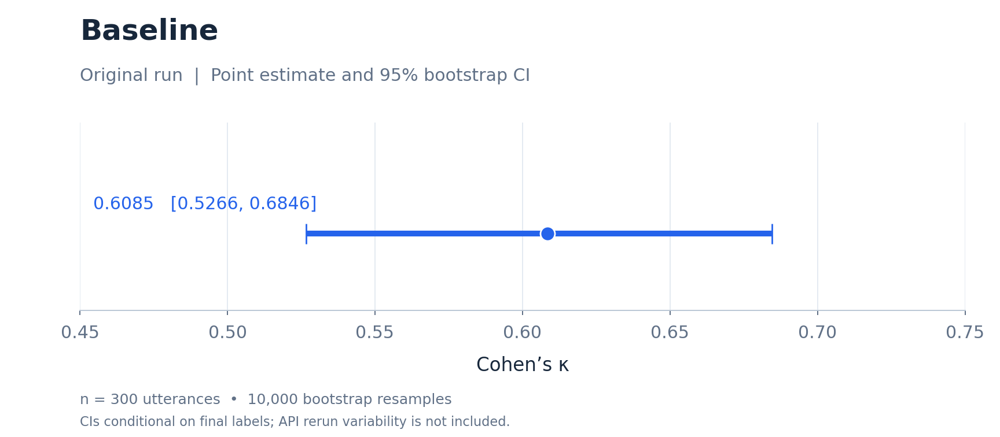 | 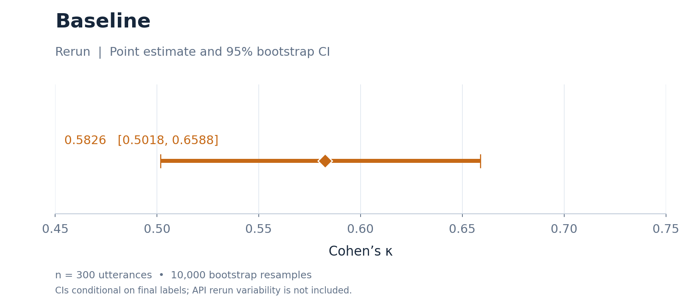 | 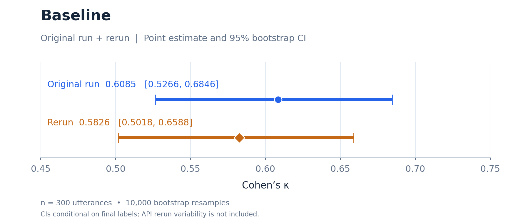 |
| Definitions replaced (Δκ) | 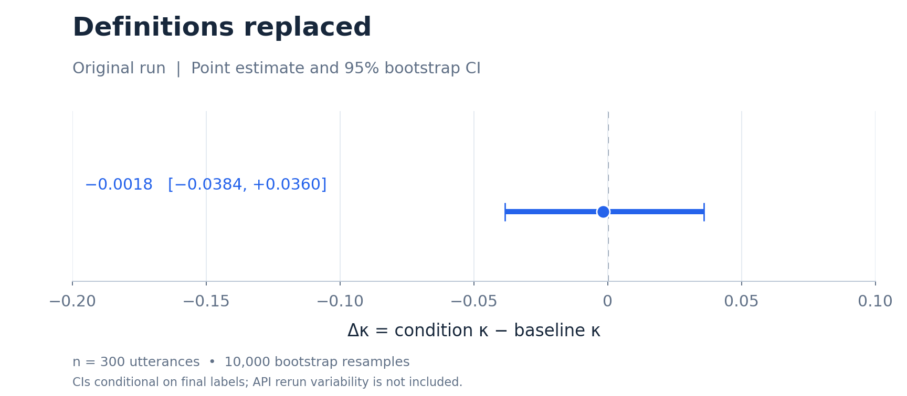 | 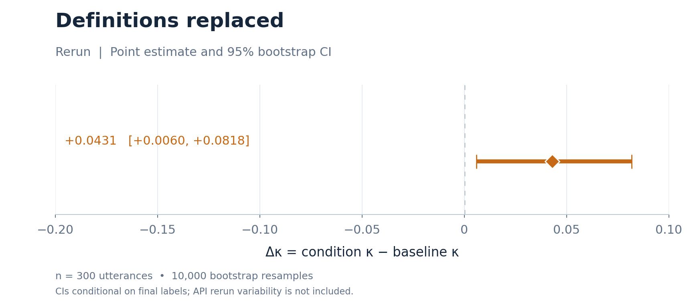 | 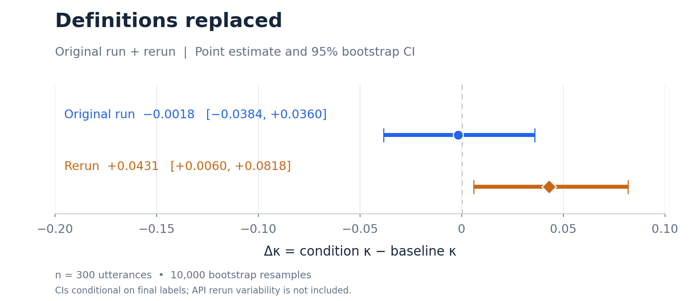 |
| Examples replaced (Δκ) | 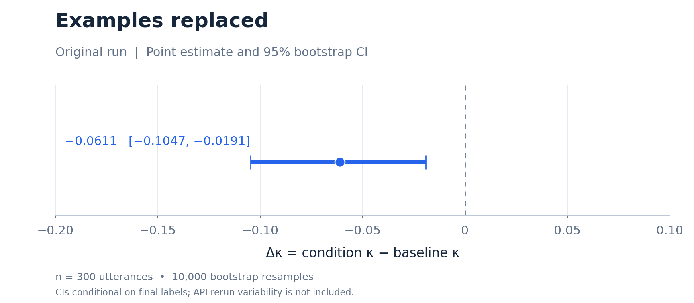 | 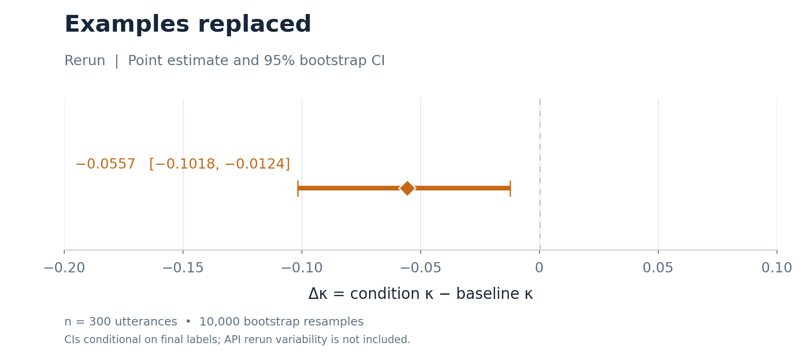 | 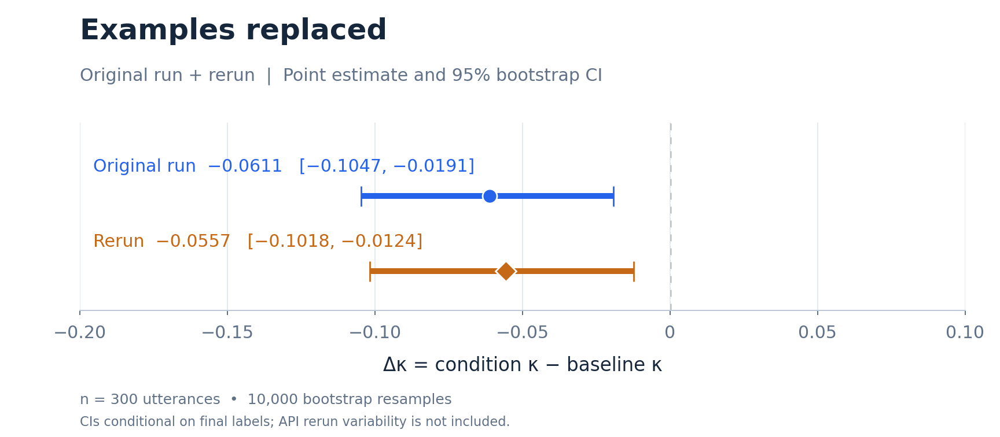 |
| Exclusion rules replaced (Δκ) | 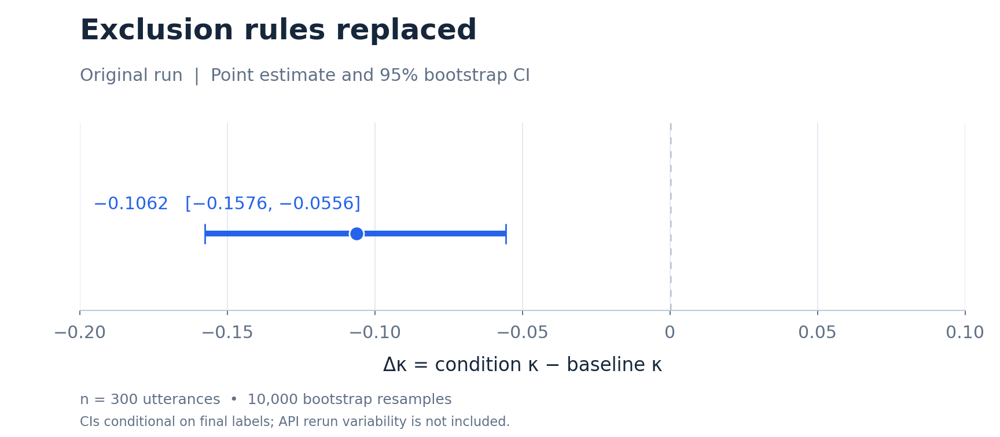 | 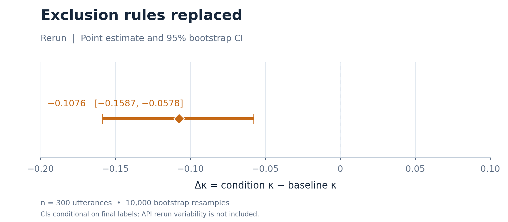 | 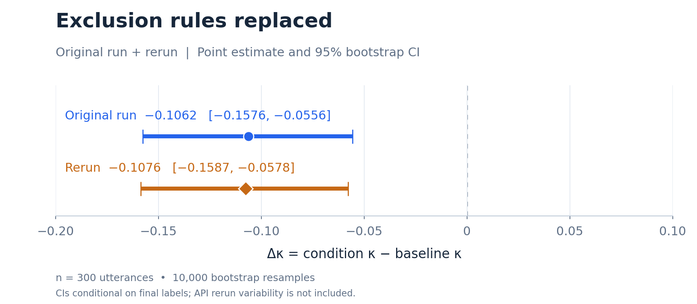 |
| Negative control (Δκ) | 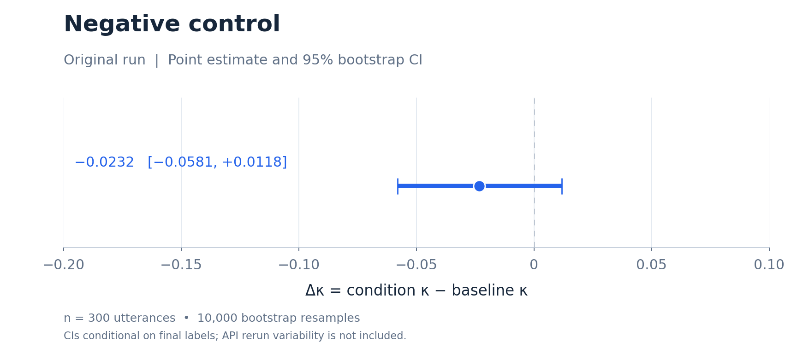 | 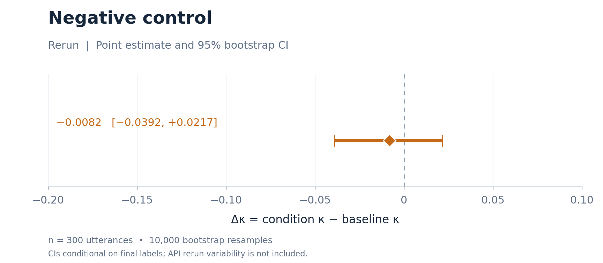 | 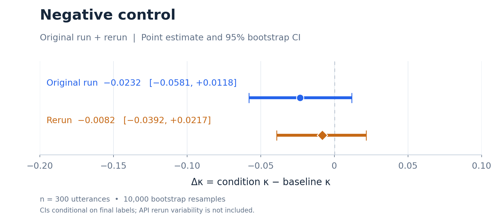 |
