## 01. Rare Category Analysis

**Source ID:** 75963  
**Human label:** Getting Students to Relate (2)

### Context

```text
T: Hand signals one and onefourth
T: Awesome
T: Sorry our board has just been acting up lately
T: One and onefourth
T: Awesome
T: Three claps for [Student A] and his team
T: Awesome job friends
[TARGET] T: Did you want to add something
T: Comment awesome
S: I agree with your answer but I did it differently on how to figure it out
T: You want to tell us
S: Yes
S: I took the five and put it over  and then I  how many times four goes into five
S: One and then there is onefourth added on to it
T: Thats great math thinking
```

### Results

1 = Keeping Everyone Together; 2 = Getting Students to Relate.

| Condition | Run (1 → 2 → 3) | Final label | Rerun (1 → 2 → 3) | Final label |
|---|---|---|---|---|
| Baseline | 2 → 1 → 1 | 1 | 1 → 1 → 1 | 1 |
| Definitions replaced | 1 → 1 → 1 | 1 | 2 → 2 → 2 | 2 |
| Examples replaced | 1 → 1 → 1 | 1 | 1 → 1 → 1 | 1 |
| Exclusion rules replaced | 2 → 2 → 2 | 2 | 2 → 2 → 2 | 2 |
| Negative control | 1 → 1 → 2 | 1 | 1 → 1 → 1 | 1 |
| Names-only | 1 → 1 → 1 | 1 | 1 → 1 → 1 | 1 |

## 02. Bootstrap Distributions

Point estimates and 95% bootstrap confidence intervals from 10,000 resamples.

| Condition | Original run | Rerun | Overlay |
|---|---|---|---|
| Baseline (κ) | 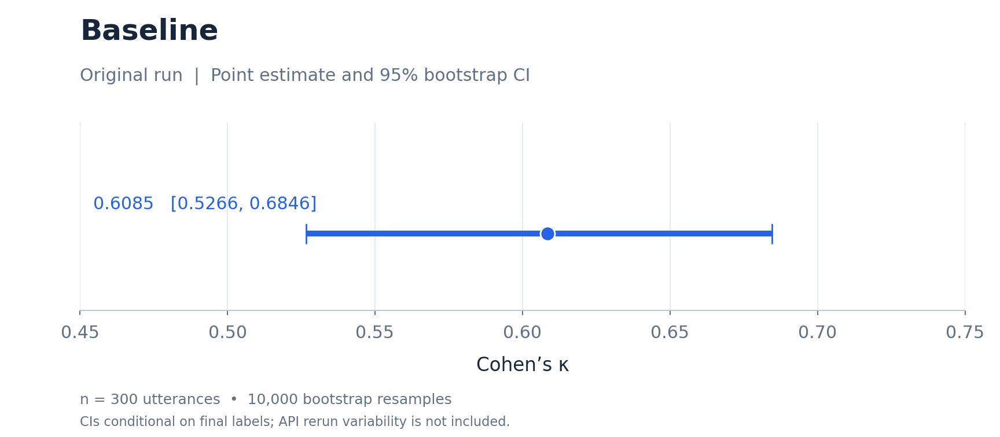 | 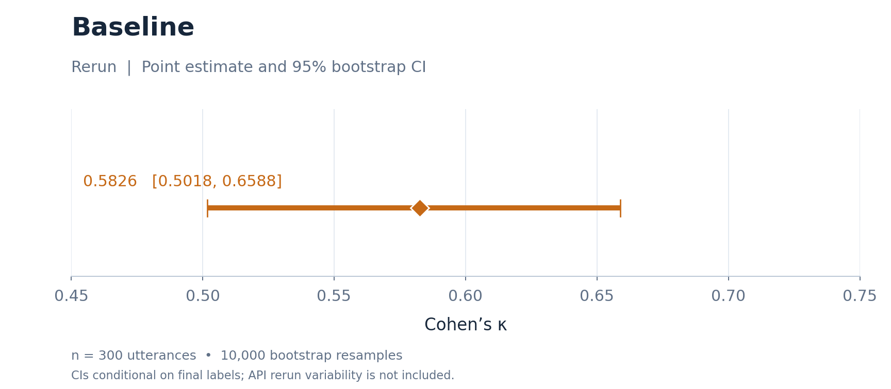 | 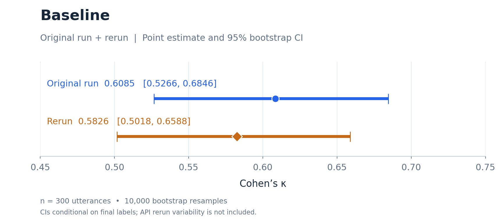 |
| Definitions replaced (Δκ) | 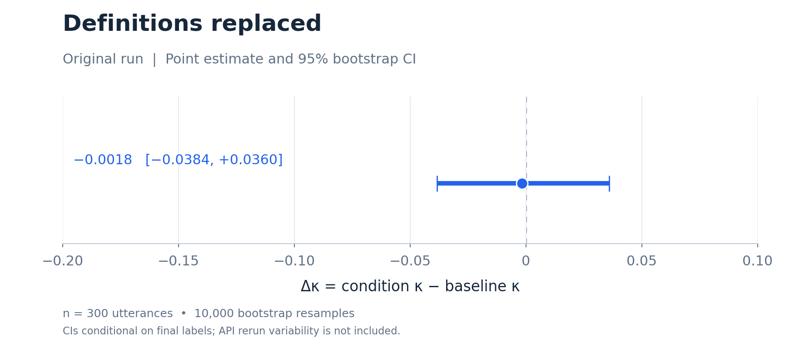 | 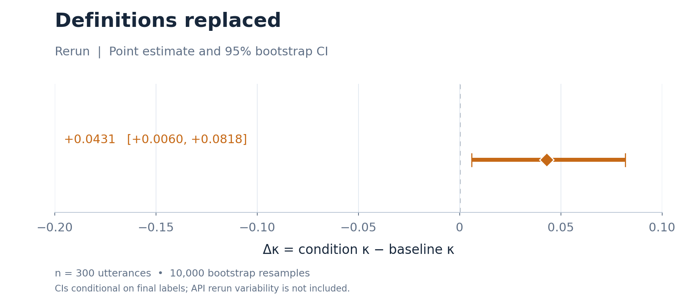 | 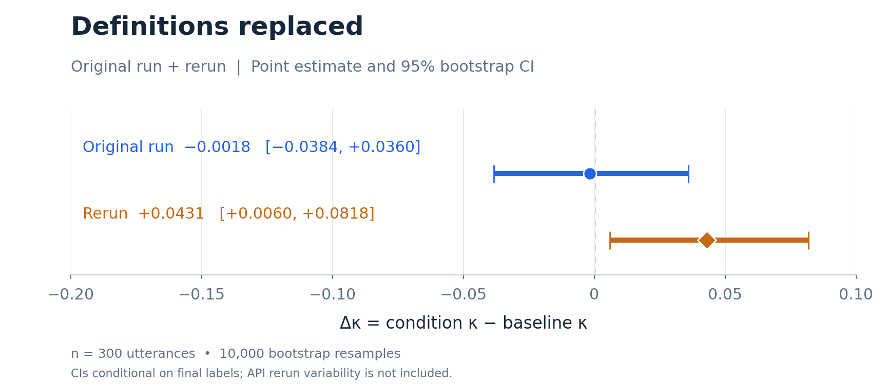 |
| Examples replaced (Δκ) | 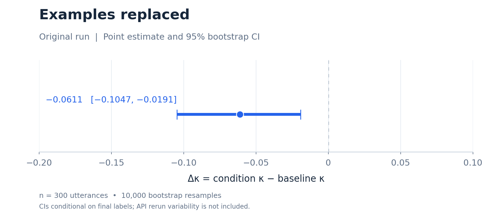 | 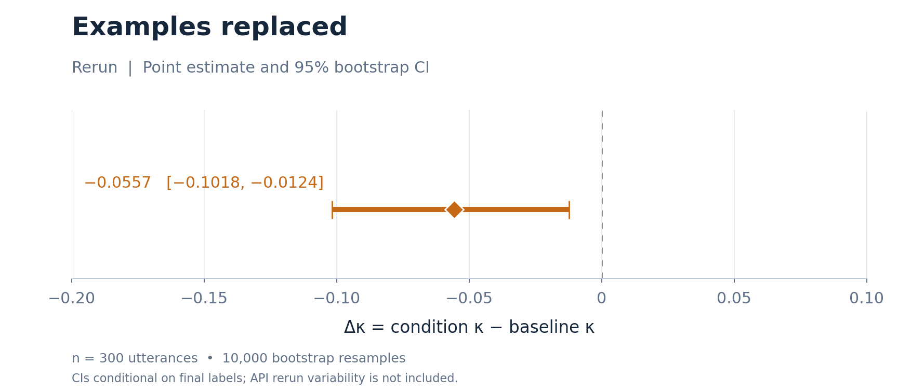 | 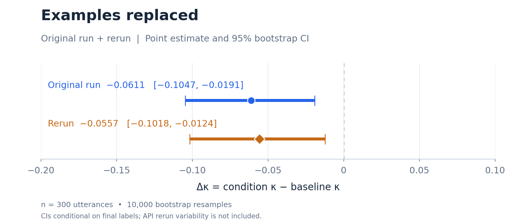 |
| Exclusion rules replaced (Δκ) | 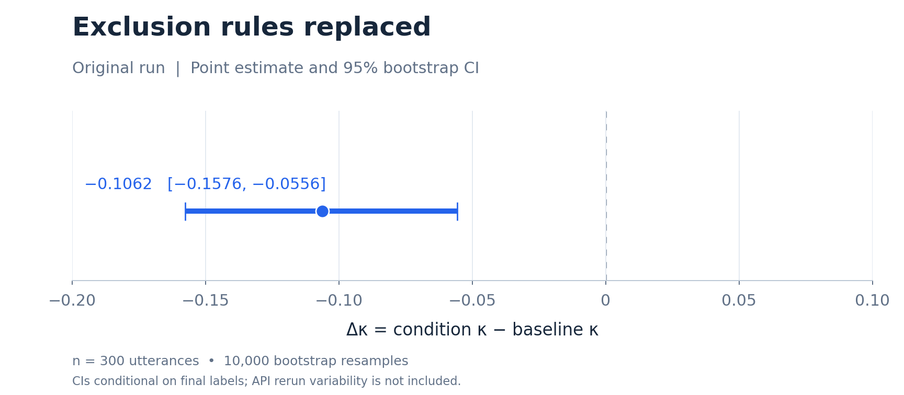 | 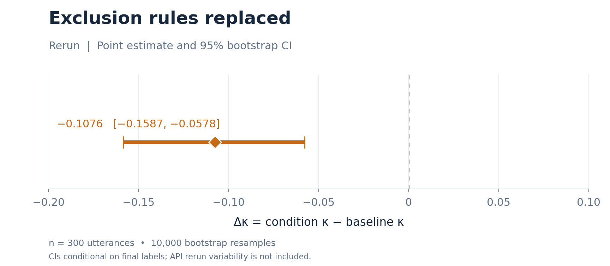 | 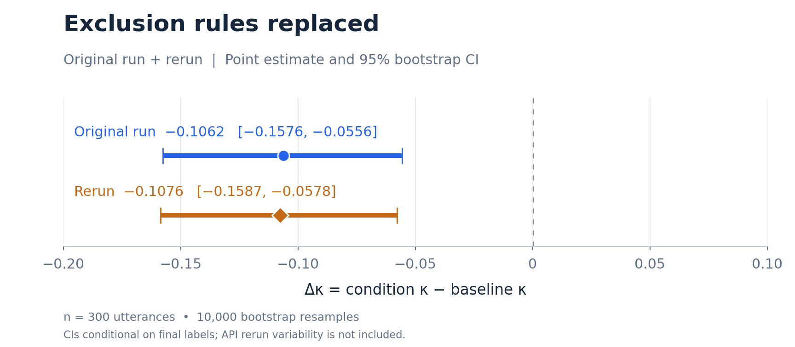 |
| Negative control (Δκ) | 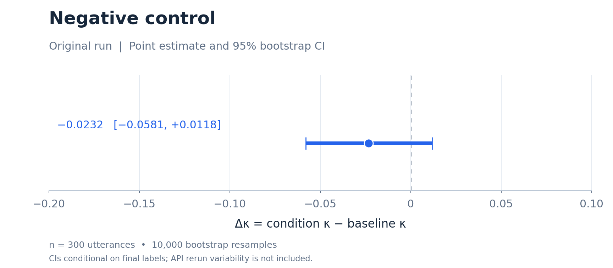 | 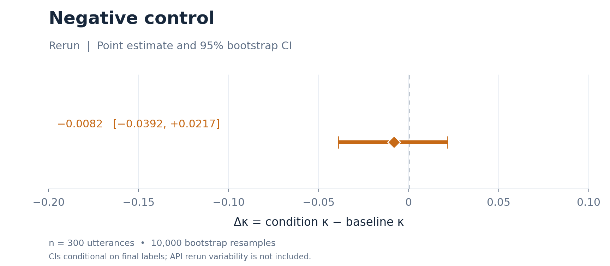 | 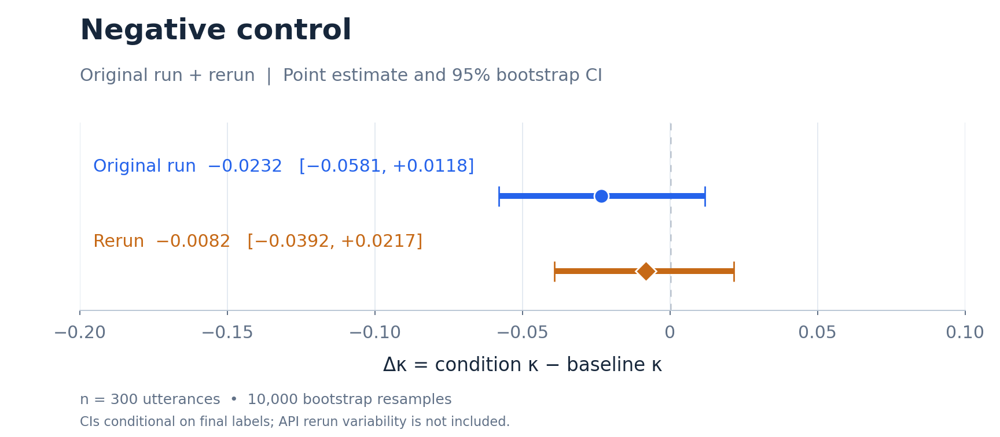 |