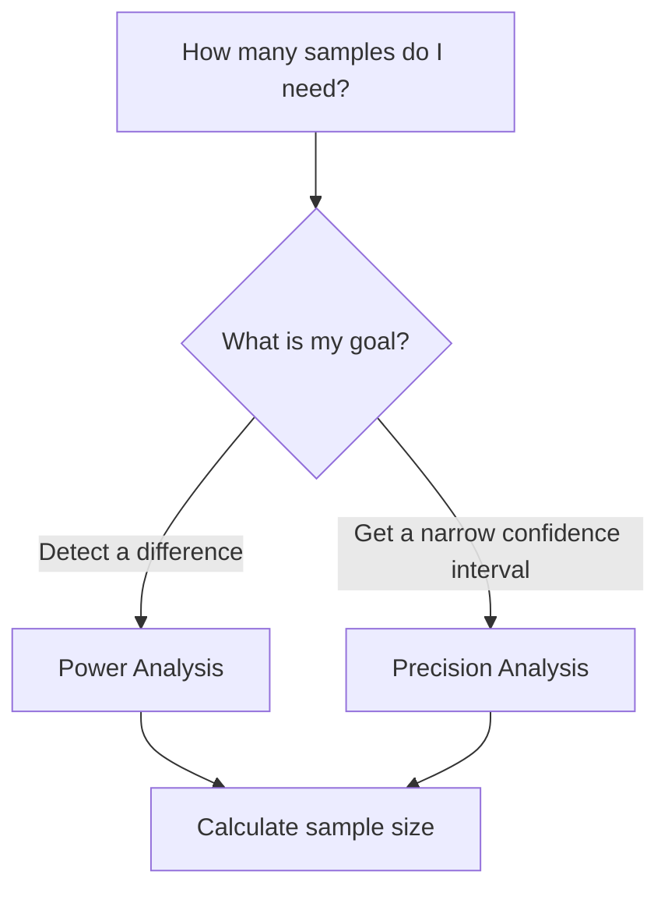
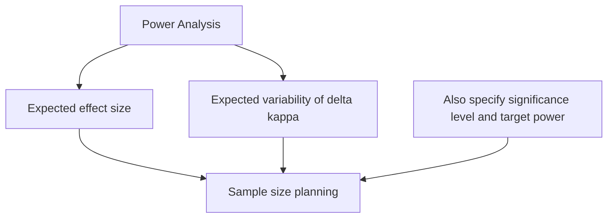
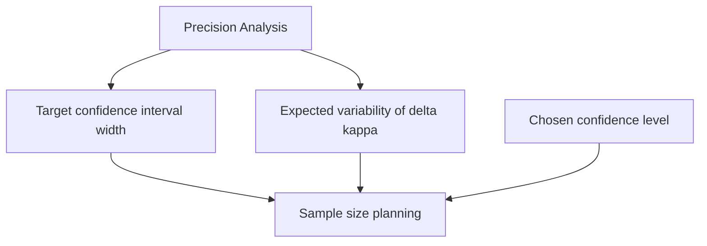
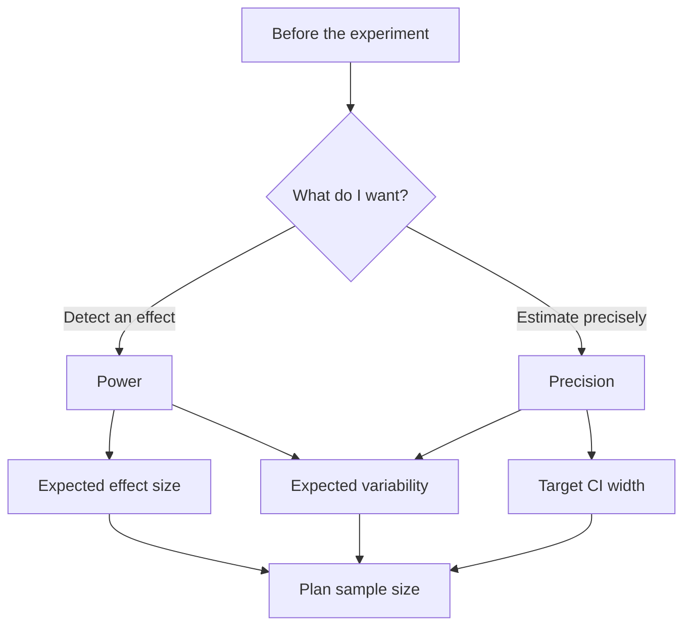

# Power Analysis vs. Precision Analysis

## 1. The Big Picture

Both methods can help researchers decide **how many samples they need before an experiment**.

But they answer different questions.

| Method | Main Question |
|---|---|
| Power Analysis | How many samples do I need to detect an effect? |
| Precision Analysis | How many samples do I need to estimate an effect precisely? |

**Power = Detecting a difference**

**Precision = Estimating a difference with a narrow confidence interval**

---

## 2. What Was I Measuring?

In my coding-manual replacement study, I compared the LLM's agreement with human labels under different conditions.

For example:

- Baseline: Full coding manual
- Examples Replacement: Examples replaced with placeholders

I measured agreement using Cohen's kappa.

Then I calculated:

**Δκ = κ(Replacement) − κ(Baseline)**

Example:

| Condition | Cohen's κ |
|---|---:|
| Baseline | 0.60 |
| Examples Replacement | 0.55 |
| Difference (Δκ) | −0.05 |

This means the replacement condition had a kappa value 0.05 lower than the baseline.

My main interest was **the change in kappa (Δκ)**.

---

## 3. Power Analysis

### Question

If replacing part of the manual really changes kappa, how many utterances would I need to have a good chance of detecting that change?

### What would I need?

**A. Expected effect size**

How much do I expect kappa to change?

For example:

- Expected Δκ = −0.05

But before my experiment, I did not know how large the change might be.

**B. Expected variability of Δκ**

How much would the estimated change in kappa vary if I sampled different utterances?

This depends partly on how the baseline and replacement conditions classify the **same utterances**.

For example:

| Utterance | Human | Baseline | Replacement |
|---|---|---|---|
| A | 0 | 0 | 0 |
| B | 1 | 1 | 5 |
| C | 5 | 0 | 5 |

The two conditions are **paired** because they classify the same utterances.

Their predictions are not independent.

To estimate the variability of Δκ, I would need information about this relationship, including the category labels and their distributions.

**Simple summary:**

A power analysis needs an expected effect size and an estimate of how much the effect would vary.

It also requires choices such as the significance level and desired statistical power.

---

## 4. Precision Analysis

### Question

How many utterances would I need to estimate Δκ with a sufficiently narrow confidence interval?

### What would I need?

**A. Target confidence interval width**

How narrow do I want my confidence interval to be?

For example:

- Target 95% CI width = 0.05

This is a goal that the researcher must choose before the analysis.

**B. Expected variability of Δκ**

How much would Δκ change across different random samples?

Greater variability usually means a wider confidence interval.

Lower variability usually means a narrower confidence interval.

With other factors held constant, increasing the sample size generally makes the confidence interval narrower.

**Simple summary:**

A precision analysis needs a target confidence interval width and an estimate of how much Δκ would vary across samples.

---

## 5. What Does Confidence Interval Width Mean?

Consider two hypothetical 95% confidence intervals.

| Estimate | 95% CI | Width |
|---|---|---|
| Δκ = −0.05 | [−0.15, 0.05] | 0.20 |
| Δκ = −0.05 | [−0.07, −0.03] | 0.04 |

Both have the same confidence level: **95%**.

But the second interval is narrower.

This means the second estimate is **more precise**.

A narrow confidence interval does not necessarily mean that the estimate is unbiased or correct.

**Confidence level and precision are different concepts.**

---

## 6. How Does This Relate to My Actual Study?

I chose **300 utterances** for practical reasons, rather than through formal power or precision analysis.

Before the experiment:

- I did not have a reliable estimate of the expected change in kappa.
- I did not have enough information to estimate how variable Δκ would be.
- I had not established a justified target confidence interval width.

After the experiment, I used **10,000 paired bootstrap resamples** to estimate uncertainty.

The bootstrap preserved the pairing between conditions by resampling the same utterance indices together.

For example, my Examples Replacement result was:

| Statistic | Result |
|---|---:|
| Δκ | −0.0611 |
| 95% CI | [−0.1047, −0.0191] |
| CI width | 0.0856 |

This confidence interval was calculated **after the experiment**.

It describes uncertainty in the observed estimate; it is not a substitute for sample size planning before the experiment.

---

## 7. Power vs. Precision: Final Comparison

| | Power Analysis | Precision Analysis |
|---|---|---|
| Main goal | Detect an effect | Estimate an effect precisely |
| Main question | Can I detect the change? | How narrow will my CI be? |
| Requires expected effect size? | Yes | Not necessarily |
| Requires variability estimate? | Yes | Yes |
| Requires a target CI width? | No | Yes |
| Used for | Sample size planning | Sample size planning |

---

## 8. One-Sentence  Aid

**Power:** How big is the expected effect, and how much might it vary?

**Precision:** How narrow do I want my confidence interval, and how much might my estimate vary?

Both need an estimate of variability.

The difference is the goal: **detecting an effect versus estimating it precisely**.
